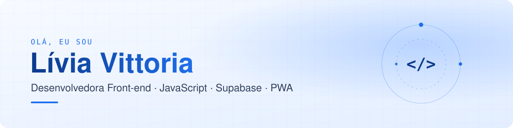

  
  
  

### Olá! Sou a Lívia Vittoria

Sou estudante de Análise e Desenvolvimento de Sistemas e desenvolvedora Full Stack. Gosto de transformar ideias em aplicações funcionais, unindo interfaces, lógica de programação, APIs e bancos de dados. Estou sempre estudando, desenvolvendo projetos e aprimorando minhas habilidades em engenharia de software.

**Como atuo:** construo a interface (HTML, CSS e JavaScript), a lógica de negócio e as APIs (Node.js e Python) e a camada de dados (PostgreSQL e Supabase, com regras de acesso no próprio banco). Documento e testo o que entrego.

### 🎓 Formação

**Análise e Desenvolvimento de Sistemas**, FATEC São Caetano do Sul (em andamento)

### 🛠️ Tecnologias

| Área | Tecnologias | Onde aplico |
|---|---|---|
| **Front-end** | HTML5 · CSS3 · JavaScript · interfaces responsivas · componentização · PWA | LumiNova, Agenda Expert, VIVA+, Portugol World, Colorarium |
| **Back-end** | Node.js · Python (FastAPI) · APIs REST · CRUD · integração entre sistemas | Agenda Expert (API própria e robô do WhatsApp), protótipo da LumiNova |
| **Banco de dados** | SQL · PostgreSQL · Supabase · modelagem de dados · Row Level Security | LumiNova, Agenda Expert, VIVA+ |
| **NoSQL** | conceitos e modelagem de bancos não relacionais | estudos (ainda sem projeto público) |
| **Ferramentas** | Git · GitHub · VS Code · Render · Figma | uso diário |

### ⭐ Projetos em destaque

<table>
  <tr>
    <td width="50%" valign="top">
      <h4><a href="https://github.com/liviavittoria28-create/Luminova">LumiNova</a></h4>
      <b>Aplicação Full Stack</b> · JavaScript · Supabase · PostgreSQL
      
Rede social brasileira organizada em comunidades e subcomunidades, com chat em tempo real, XP, conquistas e árvore de habilidades. Regras de acesso no banco (RLS em 49 tabelas) e 81 testes SQL.

      <a href="https://luminova-cwgc.onrender.com">Ver demonstração</a> · <a href="https://github.com/liviavittoria28-create/Luminova">Código</a>
    </td>
    <td width="50%" valign="top">
      <h4>Agenda Expert</h4>
      <b>Aplicação Full Stack</b> · Node.js · PostgreSQL · PWA · WhatsApp
      
Sistema em uso por uma profissional de estética: agenda com detecção de conflitos, clientes com anamnese, financeiro e confirmação automática de horários pelo WhatsApp. 81 testes automatizados.

      🔒 Repositório privado (projeto de cliente)
    </td>
  </tr>
  <tr>
    <td width="50%" valign="top">
      <h4><a href="https://github.com/liviavittoria28-create/VIVA-">VIVA+</a></h4>
      <b>Engenharia de Software</b> · JavaScript · PostgreSQL · acessibilidade
      
Plataforma de rotina e conexão familiar para pessoas idosas. Fase 1 funcional no celular. Requisitos, casos de uso, arquitetura C4/arc42, ADRs e esquema com RLS já documentados.

      <a href="https://github.com/liviavittoria28-create/VIVA-">Código e documentação</a>
    </td>
    <td width="50%" valign="top">
      <h4><a href="https://github.com/liviavittoria28-create/engenharia">Portugol World</a> · <a href="https://github.com/liviavittoria28-create/COR">Colorarium</a></h4>
      <b>Front-end e interfaces</b> · HTML · CSS · JavaScript
      
Um jogo de estudo de lógica de programação, com 11 lições e 10 desafios de código, e um catálogo interativo com 500 cores, busca e paletas.

      <a href="https://liviavittoria28-create.github.io/engenharia/">Jogar</a> · <a href="https://liviavittoria28-create.github.io/COR/">Explorar cores</a>
    </td>
  </tr>
</table>

Projetos completos em <a href="https://liviavittoria28-create.github.io">liviavittoria28-create.github.io</a>

